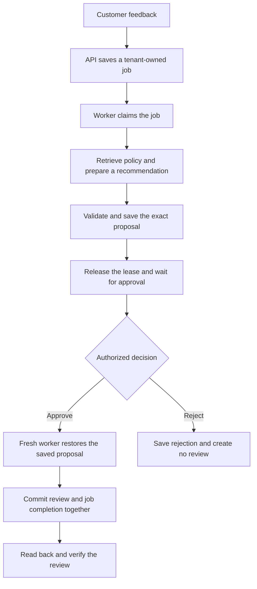

# Follow one customer request

A customer says, **“I was charged twice for my subscription.”**

The system needs to find the relevant policy and prepare a billing review.
Suppose a person approves that review later, after the original worker has
exited. How does the next worker know exactly what it is allowed to do?

This walkthrough follows that request through the working local application.
Start with its behavior. Each step links to the implementation if you want to
investigate how it works.

## Run the complete example

Use Python 3.12+ and uv. From the repository root:

```bash
uv sync --locked
uv run python -m production.category_02_models_retrieval_and_tools.integrated_feedback
```

No separate API server, Docker setup, or model server is needed for this command.
The example creates temporary SQLite databases, calls the actual FastAPI routes
through an in-process HTTP test client, and starts separate worker processes.
It prints the verified result and removes the temporary databases afterward.

The default `fixture` generator supplies a scripted recommendation. It performs
no ML inference. This lets you study the workflow reproducibly; a real Ollama
option appears below. The example also simulates the approver's decision through
the API: it automatically approves by default and rejects with `--reject`.

## The journey



### 1. Accept the request

`FeedbackAPI.submit_feedback` checks the caller's identity and submission
permission. `FeedbackStore.enqueue` saves the text, tenant, approval requirement,
and `policy` workflow mode. The API returns HTTP 202 and a job ID.

The request is accepted, but the review does not exist yet. A saved job lets the
worker pick up the work after the HTTP request has ended.

Follow [FeedbackAPI](../production/api.py) and [FeedbackStore](../production/store.py).
The isolated example configures a demonstration identity; the deployed API can
use configured API keys or OIDC access tokens.

### 2. Give one worker ownership

`FeedbackWorker.run_once` calls `FeedbackStore.claim_next`. The claim includes
the job, a token, and an attempt number. Its lease has an expiry time.

Ownership matters when a worker stalls or crashes. The store rejects writes
from an expired owner, even when that worker eventually returns a result.

Follow [FeedbackWorker](../production/worker.py) and `claim_next` in
[FeedbackStore](../production/store.py).

### 3. Find policy evidence and prepare a recommendation

`FeedbackWorkflow.prepare` calls `PolicyRetriever.search` and
`ContextBuilder.build`. For this input, keyword search finds the
**Duplicate Charges** section in the fictional support policy.

The generator receives the feedback and selected passages. `RoutingModel.recommend`
validates its JSON response, including route, reason, and citation. The workflow
also checks that the cited policy permits the selected route.

The fixture recommends `billing_review`. The recommendation is a proposal;
it has not created a review or issued a refund.

Follow [FeedbackWorkflow](../production/feedback_workflow.py),
[PolicyRetriever](../production/category_02_models_retrieval_and_tools/retrieval.py),
[ContextBuilder](../production/category_02_models_retrieval_and_tools/context.py), and
[RoutingModel](../production/category_02_models_retrieval_and_tools/models.py).

### 4. Save exactly what needs approval

The worker checks its `execute:prepare_review` permission.
`FeedbackStore.save_policy_request` then persists an immutable `ActionRequest`.
It includes the feedback, route, reason, citation, and full evidence snapshot.
The operation ID is the job ID followed by `:review`.

Here are selected proposal parameters, decoded for readability:

```json
{
  "feedback": "I was charged twice for my subscription.",
  "route": "billing_review",
  "reason": "Scripted example: request review under Duplicate Charges.",
  "source": "support_policy.md",
  "heading": "Duplicate Charges"
}
```

The actual API stores these inside `parameters_json`. Its `evidence_json`
parameter is another serialized JSON string containing the selected passages.
These fields are included in what approval authorizes.

Because approval is required, the same transaction moves the job to
`awaiting_approval` and releases the worker lease. There is still no review.

Follow [ActionRequest and ApprovalStore](../production/category_03_reliability_and_access/approvals.py)
and `save_policy_request` in [FeedbackStore](../production/store.py).

### 5. Approve and resume the saved proposal

`FeedbackAPI.decide_approval` checks the approver's tenant and permission.
`ApprovalStore.save_decision` records approval and queues the job for continuation.
A new worker claims it and calls `FeedbackWorkflow.restore`.

The second worker uses the saved evidence and parameters. It does not repeat
retrieval or ask the model for a new action after approval.

The demonstration deliberately supplies an unavailable generator and missing
policy file for this second worker. Successful completion shows that the saved
proposal is sufficient for resume. `ApprovalPolicy.require` checks that the
approval matches the action being executed.

Follow [approval handling](../production/category_03_reliability_and_access/approvals.py)
and `_process_policy` in [FeedbackWorker](../production/worker.py).

### 6. Execute, then check the durable result

`PersistentReviewTool.execute` calls `FeedbackStore.complete_policy`. Inside one
transaction, the store checks the live lease, cancellation state, saved proposal,
and required approval. It inserts the review and marks the job completed.

`PersistentReviewTool.verify` reads the durable result back and compares its
operation ID, route, reason, and citation with the proposal.

These selected output fields come from the approved scenario. Job IDs and
timestamps are omitted because they change on each run:

```json
{
  "generator": "fixture",
  "outcome": "review_created",
  "review": {
    "status": "pending_review",
    "route": "billing_review",
    "source": "support_policy.md",
    "heading": "Duplicate Charges",
    "reason": "Scripted example: request review under Duplicate Charges."
  },
  "review_count": 1
}
```

The **job is completed** because it created the requested review. The
**review is pending** because a billing investigation has not been completed.
Creating this review does not refund a payment or resolve the complaint.

Follow [PersistentReviewTool](../production/category_02_models_retrieval_and_tools/tools.py)
and `complete_policy` in [FeedbackStore](../production/store.py).

## Read the trace

The printed `stages` list includes the following sequence, with other API and
store events between these stages:

```text
worker.policy_preparation
worker.awaiting_approval
store.approved
worker.proposal_restored
worker.approval
worker.execution
worker.verification
worker.completed
```

`trace_run_id` matches the job ID. The example checks that events retain the
same job and tenant identity across worker processes. Telemetry helps explain
what happened; workflow state remains the source of truth if telemetry is missing.
See [observability](../production/category_04_evaluation_and_observability/README.md).

## Change the outcome

Predict what should happen before running each variation:

| Try | Expected behavior |
| --- | --- |
| Add `--reject` | Outcome `rejected`, job status `failed`, error `Action rejected by approver.`, and zero reviews. |
| Add `--text "Can you add dark mode?"` | Outcome `no_policy_match`, completed `record` action, no proposal, and zero reviews. The generator is skipped. |
| Run the same command again | A new isolated job is created. This is a separate request, not resuming the previous temporary database. |

The example also invokes a worker again on the same database after completion.
That invocation has no eligible job and does not create another review.

## What if the worker crashes?

The successful walkthrough uses separate worker processes; it does not inject
a crash. Run the dedicated crash exercise:

```bash
uv run python -m production.category_03_reliability_and_access.crash_and_retry
```

It uses the sentiment workflow to prove that a crashed process leaves a running
job, an expired owner cannot commit, and a replacement worker completes it with
one review. Policy-specific crash-after-proposal, timeout, and exact-resume checks
are in [the integration tests](../tests/integration/test_feedback_workflow.py):

```bash
uv run python -m unittest tests.integration.test_feedback_workflow -v
```

If policy inference times out before a proposal is saved, the worker can retry
within its attempt limit. If a proposal is already saved, a replacement worker
restores it. If execution committed but read-back verification fails, the worker
reports failure without replaying the committed action. External business APIs
would require their own idempotency and reconciliation contracts.

## Where the reusable package fits

The package in `src/everyday_agents/` teaches reusable agent contracts, ML
utilities, and the sentiment application. Its core `Agent.run` coordinates one
predict → decide → execute → verify cycle.

Production's sentiment mode reuses that package's predictor and policy, while
the worker handles durable execution. This walkthrough uses policy mode: a
separate retrieval/routing workflow with the same production storage, approval,
and recovery components. It does not invoke the sentiment model or the core
`Agent.run` method. Follow the [implementation learning path](learning-path.md#2-structure-the-implementation)
for those files and their responsibilities.

## Use a real model when you are ready

With Ollama running and a suitable model installed:

```bash
uv run python -m production.category_02_models_retrieval_and_tools.integrated_feedback --generator ollama --model qwen
```

Replace `qwen` with the exact installed model name. The adapter requests real
inference, then applies the same validation and approval boundaries. Model output
may fail validation. Local HTTP fixtures verify the adapter protocol; passing
workflow checks does not establish the reasoning quality of your model.
See [Category 02](../production/category_02_models_retrieval_and_tools/README.md)
for endpoint configuration, timeouts, and limits.

## Check your understanding

- Why does HTTP 202 not mean that a review exists?
- Why is a model's proposed route different from permission to execute it?
- What could change if we called the model again after approval?
- Why can a completed job still have a pending review?
- Which evidence would you need before trusting this model on real complaints?

Continue with the [learning path](learning-path.md), the
[architecture decisions](adr/README.md), or the
[deployed service guide](../production/category_05_deployment_and_operations/README.md).
